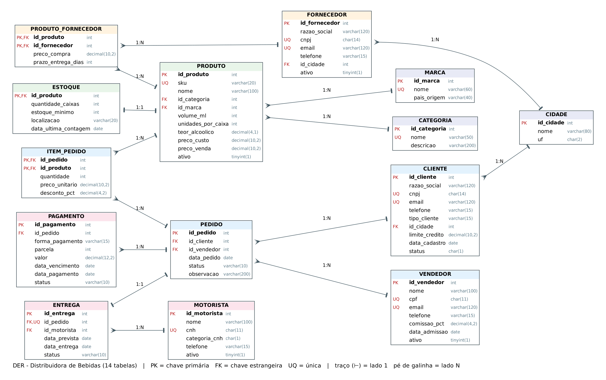

# 🍺 Distribuidora de Bebidas — Projeto Final de Banco de Dados

**AFYA Centro Universitário** · Engenharia da Computação · Disciplina: Banco de Dados · 1/2026

| | |
|---|---|
| **Integrantes** | Julia Oliveira Mota · João Victor Gomes |
| **Professor(a)** | Evandro Junior |
| **SGBD** | MySQL 8.0.16+ (SQL puro) |

## 📖 Sobre o projeto

Banco de dados relacional de uma **distribuidora de bebidas** que compra de indústrias e importadores e vende no atacado para bares, restaurantes, supermercados, hotéis e buffets. O modelo cobre catálogo de produtos, fornecedores, estoque, vendas, pagamentos parcelados e entregas.

- **14 tabelas** em **3ª Forma Normal**
- **2 relações N:N** (`produto` ↔ `fornecedor` e `pedido` ↔ `produto`), **2 relações 1:1** e **8 relações 1:N**
- Restrições `PRIMARY KEY`, `FOREIGN KEY` (com `ON DELETE`/`ON UPDATE`), `UNIQUE`, `NOT NULL`, `CHECK` (28) e `DEFAULT`
- **317 registros** fictícios e consistentes (15 ou mais por tabela)
- **19 consultas** comentadas (6 simples, 8 com JOIN/GROUP BY/HAVING e 5 de bônus com `LEFT JOIN` e subconsulta)
- Scripts auxiliares de verificação e de teste das restrições

## 🗺️ Modelo (DER)



## 📁 Estrutura do repositório

```
.
├── README.md                          ← este arquivo
├── docs/
│   ├── relatorio_tecnico.md           ← relatório técnico completo (E1, E2, E5)
│   ├── dicionario_dados.md            ← dicionário de dados (E5)
│   └── roteiro_apresentacao.md        ← roteiro da apresentação oral
├── img/
│   └── der_distribuidora_bebidas.png  ← diagrama entidade-relacionamento (E2)
└── sql/
    ├── 01_criacao_e_povoamento.sql    ← CREATE DATABASE/TABLE + INSERT (E3)
    ├── 02_consultas.sql               ← 19 consultas comentadas (E4)
    ├── 01_online_criacao_e_povoamento.sql ← versão p/ SQL online (sem CREATE/DROP DATABASE e USE)
    ├── 02_online_consultas.sql        ← consultas p/ SQL online (rodar uma por vez)
    ├── sqlite/                        ← versão só para testar no sqliteonline.com (SQLite)
    ├── 03_verificacoes.sql            ← auxiliar: contagens e integridade
    └── 04_testes_restricoes.sql       ← auxiliar: testes de CHECK/FK/UNIQUE/CASCADE
```

## ▶️ Como executar

Requer **MySQL 8.0.16 ou superior** (versões anteriores ignoram as restrições `CHECK`).

```bash
# 1. Criar o banco, as tabelas e carregar os dados (recria o banco do zero)
mysql -u root -p --default-character-set=utf8mb4 < sql/01_criacao_e_povoamento.sql

# 2. Conferir a carga (todas as verificações devem retornar OK)
mysql -u root -p --default-character-set=utf8mb4 < sql/03_verificacoes.sql

# 3. Rodar as consultas
mysql -u root -p --default-character-set=utf8mb4 -t < sql/02_consultas.sql

# 4. (Opcional) Testar restrições: os testes T1 a T8 devem falhar
mysql -u root -p --default-character-set=utf8mb4 --force < sql/04_testes_restricoes.sql
```

No **MySQL Workbench**: *File → Open SQL Script…* → abra o arquivo → execute com ⚡. Passo a passo completo na [seção 7 do relatório](docs/relatorio_tecnico.md#7-instruções-de-execução).

## 🧱 Tabelas

| Módulo | Tabelas |
|---|---|
| Cadastros básicos | `cidade`, `categoria`, `marca` |
| Compras | `fornecedor`, `produto_fornecedor` (N:N) |
| Produtos e estoque | `produto`, `estoque` (1:1) |
| Vendas | `cliente`, `vendedor`, `pedido`, `item_pedido` (N:N) |
| Financeiro e logística | `pagamento`, `motorista`, `entrega` (1:1) |

Além das tabelas, a view `vw_pedido_total` calcula o valor total de cada pedido (o total não é armazenado, para evitar redundância).

## ✅ Checklist dos requisitos

| Requisito | Atendimento |
|---|---|
| RM01 · mínimo de 8 tabelas | 14 tabelas |
| RM02 · 2 relações N:N | `produto_fornecedor` e `item_pedido` |
| RM03 · 4 relações 1:N | 8 relações 1:N (ver relatório, seção 3.1) |
| RM04 · 3ª Forma Normal | Justificada na [seção 5 do relatório](docs/relatorio_tecnico.md#5-justificativa-da-normalização), com exemplos de decomposição |
| RM05 · DER | `img/der_distribuidora_bebidas.png` |
| RM06 · Dicionário de dados | [`docs/dicionario_dados.md`](docs/dicionario_dados.md) |
| PK, FK com `ON DELETE/UPDATE`, `NOT NULL`, `UNIQUE` | Em todas as tabelas aplicáveis |
| `CHECK` em 3+ colunas / `DEFAULT` em 2+ colunas | 28 constraints `CHECK`; `DEFAULT` em diversas colunas |
| 15+ registros por tabela | Mínimo de 15, total de 317 |
| 5+ consultas simples / 5+ com JOIN | 6 simples e 8 com JOIN |
| Bônus: subconsulta, LEFT JOIN, scripts auxiliares | Q17 (subconsulta), Q15 e Q16 (LEFT JOIN), scripts `03` e `04` |

## ⚠️ Observações

- Todos os dados são **fictícios**. Marcas e produtos reais servem só como referência de catálogo; CPF/CNPJ foram gerados com dígitos verificadores válidos, mas não pertencem a pessoas ou empresas reais.
- Data de referência dos dados: 25/06/2026.
- Ferramentas auxiliares: MySQL/MySQL , Graphviz (geração do DER) e assistente de IA generativa para apoio de estudo. Os integrantes revisaram e compreendem todo o código.
