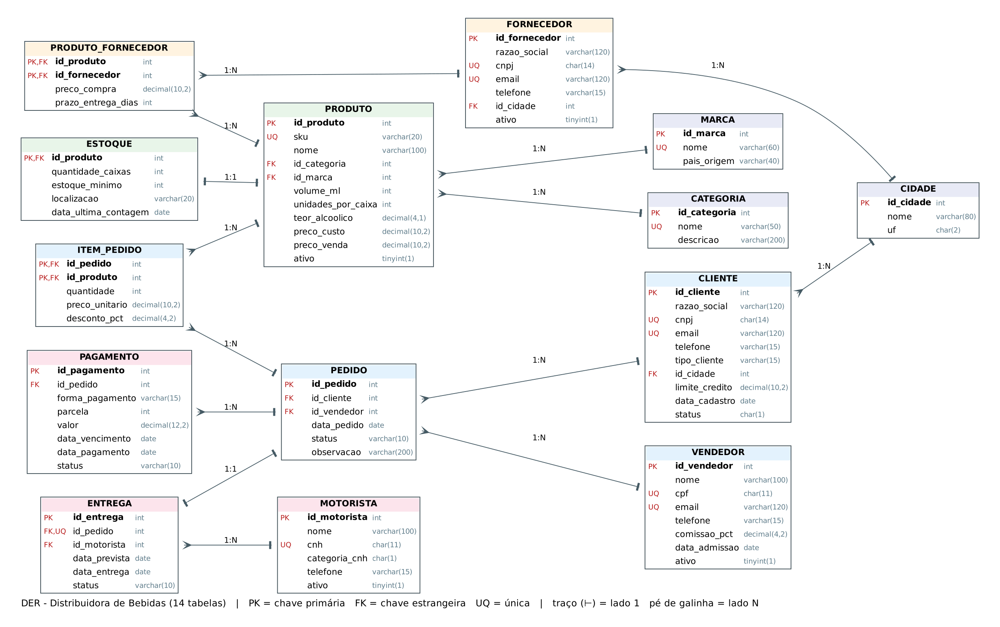

# Projeto Final de Banco de Dados — Distribuidora de Bebidas

**AFYA Centro Universitário** · Curso de Engenharia da Computação
**Disciplina:** Banco de Dados · **Semestre letivo:** 1/2026

| | |
|---|---|
| **Integrantes** | Julia Oliveira Mota — [matrícula] <br> João Victor Gomes — [matrícula] |
| **Professor(a)** | Evandro Junior |
| **Tema** | Distribuidora de bebidas (atacado para bares, restaurantes, mercados e hotéis) |
| **SGBD** | MySQL 8.0.16 ou superior |
| **Repositório** | [URL do repositório no GitHub] |

---

## 1. Resumo executivo

Este projeto modela e implementa, em MySQL, o banco de dados de uma **distribuidora de bebidas** que compra de indústrias e importadores e revende no atacado a estabelecimentos comerciais (bares, restaurantes, supermercados, hotéis, buffets e adegas). O esquema cobre o ciclo completo do negócio: cadastro de produtos, marcas e categorias; abastecimento por fornecedores; controle de estoque; vendas por vendedor; pagamentos parcelados; e entregas feitas por motoristas da frota própria.

O banco possui **14 tabelas** em **3ª Forma Normal**, com 14 chaves estrangeiras, **2 relações N:N** (produto × fornecedor e pedido × produto), **2 relações 1:1**, 8 relações 1:N explícitas e restrições `PRIMARY KEY`, `FOREIGN KEY` (com `ON DELETE`/`ON UPDATE`), `UNIQUE`, `NOT NULL`, `CHECK` e `DEFAULT`. A massa de dados é composta por **317 registros** plausíveis (mínimo de 15 por tabela) e permite que as **19 consultas** do projeto — 6 simples, 8 com JOIN/GROUP BY/HAVING e 5 de bônus com `LEFT JOIN` e subconsulta — retornem resultados significativos.

## 2. Domínio e regras de negócio

### 2.1 Cenário

A distribuidora mantém um **catálogo** de bebidas (cervejas, refrigerantes, águas, sucos, energéticos, vinhos e destilados) organizado por **categoria** e **marca**. Cada produto é vendido por **caixa/fardo** (por exemplo, caixa com 12 latas ou 6 garrafas de 2 L). Os produtos são adquiridos de **fornecedores**, e um mesmo produto pode ter mais de um fornecedor, com preços e prazos diferentes. O **estoque** de cada produto, em caixas, é acompanhado com um nível mínimo para reposição.

As vendas são feitas por **vendedores** a **clientes** (estabelecimentos comerciais) de diversas **cidades**. Cada **pedido** tem vários itens, o preço praticado e o desconto concedido em cada um. O pagamento pode ser à vista (PIX, débito, dinheiro) ou a prazo (boleto, cartão de crédito), inclusive em **parcelas**. Após o faturamento, a **entrega** é feita por um **motorista**.

### 2.2 Entidades principais

| Entidade | Papel no negócio |
|---|---|
| `cidade` | Localiza clientes e fornecedores (isola a UF, evitando redundância) |
| `categoria`, `marca` | Classificam o produto |
| `produto` | Item do catálogo, com custo, preço de venda, volume e teor alcoólico |
| `fornecedor` + `produto_fornecedor` | Quem abastece a distribuidora e a que preço/prazo |
| `estoque` | Quantidade atual e mínima de cada produto (1:1) |
| `cliente`, `vendedor` | Quem compra e quem vende |
| `pedido` + `item_pedido` | Venda e seus itens (N:N com produto) |
| `pagamento` | Parcelas financeiras do pedido |
| `motorista` + `entrega` | Logística de entrega (1:1 com pedido) |

### 2.3 Regras de negócio garantidas pelo próprio banco

| Regra | Mecanismo |
|---|---|
| Preço de venda nunca pode ser menor que o custo | `CHECK` `ck_produto_precos` |
| Desconto máximo de 30% por item; quantidade sempre positiva | `CHECK` `ck_item_desconto`, `ck_item_qtd` |
| Pedido só admite os status ABERTO, FATURADO, ENTREGUE ou CANCELADO | `CHECK` `ck_pedido_status` |
| Parcela com status PAGO exige data de pagamento (e as demais, não) | `CHECK` `ck_pagamento_data` |
| Entrega com status ENTREGUE exige data de entrega (e as demais, não) | `CHECK` `ck_entrega_data` |
| Um produto aparece uma única vez em cada pedido | PK composta (`id_pedido`, `id_produto`) |
| Um pedido tem no máximo uma entrega (1:1) | `UNIQUE` em `entrega.id_pedido` |
| CNPJ, CPF, e-mail e SKU não se repetem | `UNIQUE` |
| Cliente com pedidos, produto já vendido e pedido com pagamento/entrega não podem ser excluídos | `ON DELETE RESTRICT` |
| Ao excluir um pedido seus itens também são excluídos; ao excluir um produto ou fornecedor seus vínculos de fornecimento são removidos | `ON DELETE CASCADE` |
| Estoque não pode ficar negativo | `CHECK` `ck_estoque_qtd` |

### 2.4 Regras de processo (não implementadas no banco)

Por exigirem *triggers* ou lógica de aplicação, ficam fora do escopo deste projeto: baixar o estoque ao faturar um pedido, impedir pedidos acima do limite de crédito ou de clientes bloqueados (`status = 'B'`), e atualizar automaticamente o status das parcelas vencidas. Estão listadas como evolução na seção 9.

### 2.5 Convenções adotadas

- Preços, custos e quantidades de estoque referem-se à **caixa/fardo**.
- O valor total do pedido **não é armazenado**: é calculado a partir de `item_pedido` (view `vw_pedido_total`).
- Dados **fictícios**: marcas e produtos reais servem apenas de referência de catálogo; fornecedores e clientes são inventados; CPF/CNPJ foram gerados com dígitos verificadores válidos, mas não pertencem a pessoas ou empresas reais; os preços são aproximados.
- Data de referência da massa de dados: **25/06/2026** (pedidos de janeiro a junho de 2026).

## 3. Diagrama Entidade-Relacionamento (DER)



*Figura 1 — DER do esquema físico (14 tabelas), gerado a partir do banco implantado. Cada caixa lista os campos com tipo; `PK` = chave primária, `FK` = chave estrangeira, `UQ` = restrição de unicidade. O traço (⊢) indica o lado “1” da relação e o pé de galinha o lado “N”. As cores agrupam os módulos: cadastros básicos (azul-lavanda), compras (laranja), produtos e estoque (verde), vendas (azul) e financeiro/logística (rosa).*

### 3.1 Cardinalidades

| Tipo | Relação | Implementação |
|---|---|---|
| **N:N** | `produto` ↔ `fornecedor` | tabela associativa `produto_fornecedor` (PK composta; atributos `preco_compra`, `prazo_entrega_dias`) |
| **N:N** | `pedido` ↔ `produto` | tabela associativa `item_pedido` (PK composta; atributos `quantidade`, `preco_unitario`, `desconto_pct`) |
| **1:1** | `produto` — `estoque` | `estoque.id_produto` é PK e FK ao mesmo tempo |
| **1:1** | `pedido` — `entrega` | `entrega.id_pedido` é FK com `UNIQUE` |
| 1:N | `cidade` → `cliente` | FK `cliente.id_cidade` |
| 1:N | `cidade` → `fornecedor` | FK `fornecedor.id_cidade` |
| 1:N | `categoria` → `produto` | FK `produto.id_categoria` |
| 1:N | `marca` → `produto` | FK `produto.id_marca` |
| 1:N | `cliente` → `pedido` | FK `pedido.id_cliente` |
| 1:N | `vendedor` → `pedido` | FK `pedido.id_vendedor` |
| 1:N | `pedido` → `pagamento` | FK `pagamento.id_pedido` (um pedido pode ter várias parcelas) |
| 1:N | `motorista` → `entrega` | FK `entrega.id_motorista` |

Total: **2 relações N:N, 2 relações 1:1 e 8 relações 1:N** (requisitos mínimos: 2 e 4).

## 4. Dicionário de dados

Gerado a partir do `information_schema` do banco implantado, para garantir fidelidade ao script. `PK` = chave primária; `FK` = chave estrangeira (com a regra `ON UPDATE`/`ON DELETE` aplicada).

#### Tabela `cidade`

Municípios atendidos ou onde há fornecedores/clientes. Isolar a UF aqui elimina a dependência transitiva cidade → UF.

| Campo | Tipo | Restrições | Descrição |
|---|---|---|---|
| `id_cidade` | INT | **PK**<br>AUTO_INCREMENT | Identificador da cidade |
| `nome` | VARCHAR(80) | NOT NULL | Nome do município |
| `uf` | CHAR(2) | NOT NULL<br>CHECK `char_length(uf) = 2` | Sigla do estado (2 letras) |

#### Tabela `categoria`

Classificação comercial das bebidas (cerveja, refrigerante, destilados etc.).

| Campo | Tipo | Restrições | Descrição |
|---|---|---|---|
| `id_categoria` | INT | **PK**<br>AUTO_INCREMENT | Identificador da categoria |
| `nome` | VARCHAR(50) | UNIQUE<br>NOT NULL | Nome da categoria |
| `descricao` | VARCHAR(200) |  | Descrição resumida da categoria |

#### Tabela `marca`

Marca comercial do produto e país de origem.

| Campo | Tipo | Restrições | Descrição |
|---|---|---|---|
| `id_marca` | INT | **PK**<br>AUTO_INCREMENT | Identificador da marca |
| `nome` | VARCHAR(60) | UNIQUE<br>NOT NULL | Nome da marca |
| `pais_origem` | VARCHAR(40) | NOT NULL<br>DEFAULT Brasil | País de origem da marca |

#### Tabela `fornecedor`

Indústrias, importadores e atacadistas que abastecem a distribuidora.

| Campo | Tipo | Restrições | Descrição |
|---|---|---|---|
| `id_fornecedor` | INT | **PK**<br>AUTO_INCREMENT | Identificador do fornecedor |
| `razao_social` | VARCHAR(120) | NOT NULL | Razão social |
| `cnpj` | CHAR(14) | UNIQUE<br>NOT NULL<br>CHECK `char_length(cnpj) = 14` | CNPJ (14 dígitos, sem máscara) |
| `email` | VARCHAR(120) | UNIQUE<br>NOT NULL | E-mail comercial |
| `telefone` | VARCHAR(15) | NOT NULL | Telefone com DDD |
| `id_cidade` | INT | **FK** → cidade(id_cidade) `ON UPDATE CASCADE ON DELETE RESTRICT`<br>NOT NULL | Cidade sede do fornecedor |
| `ativo` | TINYINT(1) | NOT NULL<br>DEFAULT 1 | 1 = fornecedor ativo; 0 = inativo |

#### Tabela `produto`

Catálogo de bebidas comercializadas. Preços e quantidades referem-se à caixa/fardo.

| Campo | Tipo | Restrições | Descrição |
|---|---|---|---|
| `id_produto` | INT | **PK**<br>AUTO_INCREMENT | Identificador do produto |
| `sku` | VARCHAR(20) | UNIQUE<br>NOT NULL | Código interno único (SKU) |
| `nome` | VARCHAR(100) | NOT NULL | Nome comercial com volume/embalagem |
| `id_categoria` | INT | **FK** → categoria(id_categoria) `ON UPDATE CASCADE ON DELETE RESTRICT`<br>NOT NULL | Categoria do produto |
| `id_marca` | INT | **FK** → marca(id_marca) `ON UPDATE CASCADE ON DELETE RESTRICT`<br>NOT NULL | Marca do produto |
| `volume_ml` | INT | NOT NULL<br>CHECK `volume_ml > 0` | Volume de cada unidade, em mL |
| `unidades_por_caixa` | INT | NOT NULL<br>DEFAULT 12<br>CHECK `unidades_por_caixa > 0` | Quantidade de unidades em cada caixa/fardo |
| `teor_alcoolico` | DECIMAL(4,1) | NOT NULL<br>DEFAULT 0.0<br>CHECK `teor_alcoolico between 0 and 60` | Teor alcoólico em % (0 para não alcoólicas) |
| `preco_custo` | DECIMAL(10,2) | NOT NULL<br>CHECK `preco_custo > 0 and preco_venda >= preco_custo` | Custo atual da caixa para a distribuidora (R$) |
| `preco_venda` | DECIMAL(10,2) | NOT NULL<br>CHECK `preco_custo > 0 and preco_venda >= preco_custo` | Preço de tabela da caixa ao cliente (R$) |
| `ativo` | TINYINT(1) | NOT NULL<br>DEFAULT 1 | 1 = em linha; 0 = descontinuado |

#### Tabela `produto_fornecedor`

Associativa N:N entre produto e fornecedor: quem fornece o quê, a que preço e em quantos dias.

| Campo | Tipo | Restrições | Descrição |
|---|---|---|---|
| `id_produto` | INT | **PK**<br>**FK** → produto(id_produto) `ON UPDATE CASCADE ON DELETE CASCADE` | Produto fornecido |
| `id_fornecedor` | INT | **PK**<br>**FK** → fornecedor(id_fornecedor) `ON UPDATE CASCADE ON DELETE CASCADE` | Fornecedor do produto |
| `preco_compra` | DECIMAL(10,2) | NOT NULL<br>CHECK `preco_compra > 0` | Preço da caixa praticado pelo fornecedor (R$) |
| `prazo_entrega_dias` | INT | NOT NULL<br>DEFAULT 7<br>CHECK `prazo_entrega_dias between 1 and 60` | Prazo de entrega do fornecedor, em dias |

#### Tabela `estoque`

Posição de estoque de cada produto (relação 1:1 com produto), em caixas.

| Campo | Tipo | Restrições | Descrição |
|---|---|---|---|
| `id_produto` | INT | **PK**<br>**FK** → produto(id_produto) `ON UPDATE CASCADE ON DELETE CASCADE` | Produto (PK e FK: relação 1:1) |
| `quantidade_caixas` | INT | NOT NULL<br>DEFAULT 0<br>CHECK `quantidade_caixas >= 0` | Quantidade atual em caixas |
| `estoque_minimo` | INT | NOT NULL<br>DEFAULT 20<br>CHECK `estoque_minimo >= 0` | Nível mínimo antes de acionar reposição |
| `localizacao` | VARCHAR(20) | NOT NULL | Posição no armazém (corredor-prateleira) |
| `data_ultima_contagem` | DATE | NOT NULL | Data do último inventário |

#### Tabela `cliente`

Estabelecimentos comerciais compradores (bares, restaurantes, mercados, hotéis etc.).

| Campo | Tipo | Restrições | Descrição |
|---|---|---|---|
| `id_cliente` | INT | **PK**<br>AUTO_INCREMENT | Identificador do cliente |
| `razao_social` | VARCHAR(120) | NOT NULL | Razão social do estabelecimento |
| `cnpj` | CHAR(14) | UNIQUE<br>NOT NULL<br>CHECK `char_length(cnpj) = 14` | CNPJ (14 dígitos, sem máscara) |
| `email` | VARCHAR(120) | UNIQUE<br>NOT NULL | E-mail de contato |
| `telefone` | VARCHAR(15) | NOT NULL | Telefone com DDD |
| `tipo_cliente` | VARCHAR(15) | NOT NULL<br>CHECK `tipo_cliente in ('BAR','RESTAURANTE','SUPERMERCADO','PADARIA','LANCHONETE','HOTEL','EVENTOS','ADEGA','CONVENIENCIA')` | Segmento do cliente (BAR, RESTAURANTE, SUPERMERCADO, ...) |
| `id_cidade` | INT | **FK** → cidade(id_cidade) `ON UPDATE CASCADE ON DELETE RESTRICT`<br>NOT NULL | Cidade do cliente |
| `limite_credito` | DECIMAL(10,2) | NOT NULL<br>DEFAULT 5000.00<br>CHECK `limite_credito >= 0` | Limite de crédito concedido (R$) |
| `data_cadastro` | DATE | NOT NULL<br>DEFAULT curdate() | Data de cadastro do cliente |
| `status` | CHAR(1) | NOT NULL<br>DEFAULT A<br>CHECK `status in ('A','I','B')` | A = Ativo; I = Inativo; B = Bloqueado |

#### Tabela `vendedor`

Equipe comercial responsável pelos pedidos e remunerada por comissão.

| Campo | Tipo | Restrições | Descrição |
|---|---|---|---|
| `id_vendedor` | INT | **PK**<br>AUTO_INCREMENT | Identificador do vendedor |
| `nome` | VARCHAR(100) | NOT NULL | Nome completo |
| `cpf` | CHAR(11) | UNIQUE<br>NOT NULL<br>CHECK `char_length(cpf) = 11` | CPF (11 dígitos, sem máscara) |
| `email` | VARCHAR(120) | UNIQUE<br>NOT NULL | E-mail corporativo |
| `telefone` | VARCHAR(15) | NOT NULL | Telefone com DDD |
| `comissao_pct` | DECIMAL(4,2) | NOT NULL<br>DEFAULT 2.00<br>CHECK `comissao_pct between 0 and 20` | Percentual de comissão sobre vendas (%) |
| `data_admissao` | DATE | NOT NULL | Data de admissão |
| `ativo` | TINYINT(1) | NOT NULL<br>DEFAULT 1 | 1 = em atividade; 0 = desligado |

#### Tabela `motorista`

Motoristas da frota própria que realizam as entregas.

| Campo | Tipo | Restrições | Descrição |
|---|---|---|---|
| `id_motorista` | INT | **PK**<br>AUTO_INCREMENT | Identificador do motorista |
| `nome` | VARCHAR(100) | NOT NULL | Nome completo |
| `cnh` | CHAR(11) | UNIQUE<br>NOT NULL | Número da CNH (11 dígitos) |
| `categoria_cnh` | CHAR(1) | NOT NULL<br>DEFAULT C<br>CHECK `categoria_cnh in ('B','C','D','E')` | Categoria da habilitação (B, C, D ou E) |
| `telefone` | VARCHAR(15) | NOT NULL | Telefone com DDD |
| `ativo` | TINYINT(1) | NOT NULL<br>DEFAULT 1 | 1 = em atividade; 0 = inativo |

#### Tabela `pedido`

Cabeçalho do pedido de venda. O valor total é derivado dos itens (view vw_pedido_total).

| Campo | Tipo | Restrições | Descrição |
|---|---|---|---|
| `id_pedido` | INT | **PK**<br>AUTO_INCREMENT | Identificador do pedido |
| `id_cliente` | INT | **FK** → cliente(id_cliente) `ON UPDATE CASCADE ON DELETE RESTRICT`<br>NOT NULL | Cliente comprador |
| `id_vendedor` | INT | **FK** → vendedor(id_vendedor) `ON UPDATE CASCADE ON DELETE RESTRICT`<br>NOT NULL | Vendedor responsável |
| `data_pedido` | DATE | NOT NULL | Data de emissão do pedido |
| `status` | VARCHAR(10) | NOT NULL<br>DEFAULT ABERTO<br>CHECK `status in ('ABERTO','FATURADO','ENTREGUE','CANCELADO')` | ABERTO, FATURADO, ENTREGUE ou CANCELADO |
| `observacao` | VARCHAR(200) |  | Observações livres do pedido |

#### Tabela `item_pedido`

Associativa N:N entre pedido e produto: itens vendidos, com preço praticado e desconto.

| Campo | Tipo | Restrições | Descrição |
|---|---|---|---|
| `id_pedido` | INT | **PK**<br>**FK** → pedido(id_pedido) `ON UPDATE CASCADE ON DELETE CASCADE` | Pedido ao qual o item pertence |
| `id_produto` | INT | **PK**<br>**FK** → produto(id_produto) `ON UPDATE CASCADE ON DELETE RESTRICT` | Produto vendido |
| `quantidade` | INT | NOT NULL<br>CHECK `quantidade > 0` | Quantidade vendida, em caixas |
| `preco_unitario` | DECIMAL(10,2) | NOT NULL<br>CHECK `preco_unitario > 0` | Preço da caixa praticado na data da venda (R$) |
| `desconto_pct` | DECIMAL(4,2) | NOT NULL<br>DEFAULT 0.00<br>CHECK `desconto_pct between 0 and 30` | Desconto concedido no item (%) |

#### Tabela `pagamento`

Parcelas de pagamento de um pedido (1:N com pedido).

| Campo | Tipo | Restrições | Descrição |
|---|---|---|---|
| `id_pagamento` | INT | **PK**<br>AUTO_INCREMENT | Identificador da parcela de pagamento |
| `id_pedido` | INT | **FK** → pedido(id_pedido) `ON UPDATE CASCADE ON DELETE RESTRICT`<br>NOT NULL | Pedido pago |
| `forma_pagamento` | VARCHAR(15) | NOT NULL<br>CHECK `forma_pagamento in ('PIX','BOLETO','CARTAO_CREDITO','CARTAO_DEBITO','DINHEIRO')` | PIX, BOLETO, CARTAO_CREDITO, CARTAO_DEBITO ou DINHEIRO |
| `parcela` | INT | NOT NULL<br>DEFAULT 1<br>CHECK `parcela > 0` | Número da parcela dentro do pedido |
| `valor` | DECIMAL(12,2) | NOT NULL<br>CHECK `valor > 0` | Valor da parcela (R$) |
| `data_vencimento` | DATE | NOT NULL | Data de vencimento |
| `data_pagamento` | DATE | CHECK `status = 'PAGO' and data_pagamento is not null or status <> 'PAGO' and data_pagamento is null` | Data em que foi paga (nula se não paga) |
| `status` | VARCHAR(10) | NOT NULL<br>DEFAULT PENDENTE<br>CHECK `status in ('PENDENTE','PAGO','ATRASADO')`<br>CHECK `status = 'PAGO' and data_pagamento is not null or status <> 'PAGO' and data_pagamento is null` | PENDENTE, PAGO ou ATRASADO |

#### Tabela `entrega`

Entrega física de um pedido (1:1 com pedido), com motorista e datas.

| Campo | Tipo | Restrições | Descrição |
|---|---|---|---|
| `id_entrega` | INT | **PK**<br>AUTO_INCREMENT | Identificador da entrega |
| `id_pedido` | INT | **FK** → pedido(id_pedido) `ON UPDATE CASCADE ON DELETE RESTRICT`<br>UNIQUE<br>NOT NULL | Pedido entregue (único: relação 1:1) |
| `id_motorista` | INT | **FK** → motorista(id_motorista) `ON UPDATE CASCADE ON DELETE RESTRICT`<br>NOT NULL | Motorista responsável |
| `data_prevista` | DATE | NOT NULL | Data prevista de entrega |
| `data_entrega` | DATE | CHECK `status = 'ENTREGUE' and data_entrega is not null or status <> 'ENTREGUE' and data_entrega is null` | Data efetiva (nula enquanto não entregue) |
| `status` | VARCHAR(10) | NOT NULL<br>DEFAULT AGENDADA<br>CHECK `status in ('AGENDADA','EM_ROTA','ENTREGUE','FALHA')`<br>CHECK `status = 'ENTREGUE' and data_entrega is not null or status <> 'ENTREGUE' and data_entrega is null` | AGENDADA, EM_ROTA, ENTREGUE ou FALHA |

## 5. Justificativa da normalização

O esquema foi projetado para atingir a **3ª Forma Normal (3FN)**, eliminando redundâncias e anomalias de inserção, atualização e exclusão.

### 5.1 Primeira Forma Normal (1FN)

Todos os atributos são **atômicos** e não há grupos repetitivos. Em vez de colocar os produtos dentro do pedido (`produto1`, `qtd1`, `produto2`, `qtd2`, …), cada item é uma linha em `item_pedido`. O mesmo vale para as parcelas de pagamento (uma linha por parcela em `pagamento`) e para os vínculos produto × fornecedor.

### 5.2 Segunda Forma Normal (2FN)

Como a 2FN trata de dependência parcial da chave, ela só importa nas tabelas com **chave composta**: `item_pedido (id_pedido, id_produto)` e `produto_fornecedor (id_produto, id_fornecedor)`.

- Em `item_pedido`, `quantidade`, `preco_unitario` e `desconto_pct` dependem do **par** pedido-produto. O `nome` do produto, que dependeria apenas de `id_produto`, **fica em `produto`**, e não é repetido nos itens.
- Em `produto_fornecedor`, `preco_compra` e `prazo_entrega_dias` dependem do **par** produto-fornecedor, pois cada fornecedor cobra um preço diferente pelo mesmo produto.

### 5.3 Terceira Forma Normal (3FN)

Não há **dependências transitivas** entre atributos não-chave. Os dois principais exemplos de decomposição estão a seguir.

#### Exemplo 1 — Decomposição de `cidade` / `uf`

Numa versão inicial, a tabela de clientes guardaria a cidade e a UF diretamente:

```
cliente_inicial (id_cliente, razao_social, cnpj, ..., cidade, uf)
```

Aqui existe a dependência transitiva `id_cliente → cidade → uf`. Isso provoca anomalias:

| Anomalia | Problema |
|---|---|
| Atualização | Corrigir a UF de “Montes Claros” exigiria alterar todos os clientes da cidade, e uma falha deixaria dados inconsistentes |
| Inserção | Não seria possível cadastrar uma cidade (ex.: para um fornecedor futuro) sem um cliente |
| Exclusão | Excluir o único cliente de uma cidade apagaria o único registro da cidade e de sua UF |

**Decomposição aplicada:**

```
cidade  (id_cidade PK, nome, uf)
cliente (id_cliente PK, ..., id_cidade FK)
fornecedor (id_fornecedor PK, ..., id_cidade FK)
```

A tabela `cidade` é compartilhada por `cliente` e `fornecedor`, e cada cidade e sua UF são armazenadas uma única vez.

#### Exemplo 2 — Decomposição de `categoria` e `marca`

Se `produto` guardasse `nome_categoria`, `descricao_categoria`, `nome_marca` e `pais_origem_marca`, esses dados se repetiriam em dezenas de linhas (`id_produto → id_marca → pais_origem`). Com `categoria` e `marca` em tabelas próprias, cada informação existe uma única vez e `produto` guarda só as FKs.

#### Exemplo 3 — Atributo derivado não armazenado

Um campo `valor_total` em `pedido` seria **redundante**, pois pode ser calculado como a soma dos itens, e ficaria desatualizado se um item fosse alterado. Por isso o total não é armazenado e é obtido pela view `vw_pedido_total` (e pelas consultas Q09, Q11 e Q17).

### 5.4 Decisões que podem parecer redundância, mas não são

| Atributo | Por que está correto |
|---|---|
| `item_pedido.preco_unitario` | É o preço **praticado na data da venda** (histórico). Sem ele, uma alteração em `produto.preco_venda` reescreveria o valor de pedidos antigos. Na massa de dados, pedidos anteriores a 15/03/2026 usam preços 4% menores. |
| `produto.preco_custo` e `produto_fornecedor.preco_compra` | Semânticas diferentes: o primeiro é o **custo atual** da caixa para a distribuidora (base de margem); o segundo é a **tabela de preços de cada fornecedor**, que varia entre eles. |
| `estoque` separada de `produto` (1:1) | Separa dados **voláteis** (quantidade, contagem) do cadastro estável do produto, reduzindo bloqueios e facilitando auditoria. |
| `cliente.tipo_cliente` e `status` como texto com `CHECK` | O domínio é pequeno e estável. A alternativa seria uma tabela de domínio, descrita como evolução possível. |

**Conclusão:** em todas as 14 tabelas, cada atributo não-chave depende da chave, de toda a chave e **somente** da chave (“the key, the whole key and nothing but the key”), o que caracteriza a 3FN.

## 6. Catálogo de consultas

As 19 consultas estão no arquivo [`sql/02_consultas.sql`](../sql/02_consultas.sql), com comentários explicativos. Todas retornam resultados não vazios com a massa de dados fornecida. As saídas abaixo foram obtidas da execução real do script.

**Cobertura dos requisitos:** 6 consultas simples (Q01–Q06: `WHERE`, `ORDER BY`, `LIKE`, `BETWEEN`, `IN`, `DISTINCT`, `LIMIT`) e 8 consultas com `INNER JOIN` (Q07–Q14). Todas as 8 usam 2 ou mais tabelas; 6 delas usam 3 ou mais (Q09 a Q14). Sete combinam `JOIN` com `GROUP BY` e funções de agregação (Q07 a Q12 e Q14), e Q08, Q09, Q12 e Q14 acrescentam `HAVING`. Q13 usa `JOIN` com expressão aritmética. Q15 e Q16 usam `LEFT JOIN`, Q17 usa subconsulta, e Q18 e Q19 são análises operacionais adicionais.

### Consultas simples (Q01–Q06)

#### Q01 — Os 10 produtos ativos mais caros do catálogo.

**Pergunta de negócio:** Quais são os produtos mais caros do catálogo ativo? (apoia decisões de precificação e de capital de giro)

**Recursos SQL:** WHERE, ORDER BY, LIMIT

```sql
SELECT sku, nome, preco_venda
FROM   produto
WHERE  ativo = 1
ORDER  BY preco_venda DESC
LIMIT  10;
```

**Exemplo de saída:**

| sku | nome | preco_venda |
|---|---|---|
| WHI-021 | Johnnie Walker Red Label 1L | 1090.00 |
| VOD-022 | Smirnoff Vodka 998ml | 489.00 |
| ENE-015 | Red Bull Energy Drink 250ml | 249.00 |
| CER-007 | Colorado Appia Garrafa 600ml | 219.00 |
| ESP-019 | Salton Brut Espumante 750ml | 214.00 |
| CAC-020 | Cachaça Salinas Tradicional 700ml | 204.00 |
| VIN-017 | Salton Classic Merlot 750ml | 152.00 |
| VIN-018 | Salton Classic Chardonnay 750ml | 149.00 |
| CER-004 | Heineken Long Neck 330ml | 145.00 |
| CER-006 | Budweiser Long Neck 330ml | 119.90 |

*(10 linhas)*

#### Q02 — Produtos vendidos em lata, em ordem alfabética.

**Pergunta de negócio:** Quais produtos são comercializados em lata? (útil para montar ofertas por tipo de embalagem)

**Recursos SQL:** LIKE, ORDER BY

```sql
SELECT id_produto, nome, volume_ml, unidades_por_caixa, preco_venda
FROM   produto
WHERE  nome LIKE '%Lata%'
ORDER  BY nome;
```

**Exemplo de saída:**

| id_produto | nome | volume_ml | unidades_por_caixa | preco_venda |
|---|---|---|---|---|
| 3 | Antarctica Pilsen Lata 350ml | 350 | 12 | 40.50 |
| 2 | Brahma Chopp Lata 350ml | 350 | 12 | 41.90 |
| 11 | Coca-Cola Lata 350ml | 350 | 12 | 38.90 |
| 5 | Heineken Lata 350ml | 350 | 12 | 68.90 |
| 1 | Skol Pilsen Lata 350ml | 350 | 12 | 39.90 |

*(5 linhas)*

#### Q03 — Pedidos faturados ou entregues em março de 2026.

**Pergunta de negócio:** Quais pedidos efetivados (faturados/entregues) ocorreram em março de 2026? (fechamento mensal)

**Recursos SQL:** BETWEEN, IN, ORDER BY

```sql
SELECT id_pedido, id_cliente, id_vendedor, data_pedido, status
FROM   pedido
WHERE  data_pedido BETWEEN '2026-03-01' AND '2026-03-31'
  AND  status IN ('FATURADO', 'ENTREGUE')
ORDER  BY data_pedido, id_pedido;
```

**Exemplo de saída:**

| id_pedido | id_cliente | id_vendedor | data_pedido | status |
|---|---|---|---|---|
| 7 | 16 | 13 | 2026-03-02 | ENTREGUE |
| 8 | 7 | 8 | 2026-03-12 | ENTREGUE |
| 9 | 8 | 1 | 2026-03-23 | ENTREGUE |

*(3 linhas)*

#### Q04 — Bares e restaurantes ativos, em ordem alfabética.

**Pergunta de negócio:** Quais bares e restaurantes ativos temos e qual o limite de crédito de cada um? (segmento prioritário da distribuidora)

**Recursos SQL:** IN, AND, ORDER BY

```sql
SELECT id_cliente, razao_social, tipo_cliente, limite_credito
FROM   cliente
WHERE  tipo_cliente IN ('BAR', 'RESTAURANTE')
  AND  status = 'A'
ORDER  BY razao_social;
```

**Exemplo de saída:**

| id_cliente | razao_social | tipo_cliente | limite_credito |
|---|---|---|---|
| 1 | Bar do Zé Mineiro | BAR | 8000.00 |
| 9 | Bar e Petiscaria do Cais Ltda | BAR | 7000.00 |
| 5 | Boteco Esquina da Praça Ltda | BAR | 5000.00 |
| 16 | Cantina Bella Napoli Ltda | RESTAURANTE | 14000.00 |
| 6 | Churrascaria Fogo Mineiro Ltda | RESTAURANTE | 20000.00 |
| 11 | Pizzaria Forno a Lenha Ltda | RESTAURANTE | 12000.00 |
| 2 | Restaurante Sabor de Minas Ltda | RESTAURANTE | 15000.00 |

*(7 linhas)*

#### Q05 — Formas de pagamento efetivamente utilizadas.

**Pergunta de negócio:** Quais formas de pagamento os clientes realmente utilizam? (planejamento financeiro e de taxas)

**Recursos SQL:** DISTINCT, ORDER BY

```sql
SELECT DISTINCT forma_pagamento
FROM   pagamento
ORDER  BY forma_pagamento;
```

**Exemplo de saída:**

| forma_pagamento |
|---|
| BOLETO |
| CARTAO_CREDITO |
| DINHEIRO |
| PIX |

*(4 linhas)*

#### Q06 — Vendedores admitidos até 2021 com comissão de 2,5% ou mais.

**Pergunta de negócio:** Quais vendedores mais antigos têm comissão de 2,5% ou mais? (política de remuneração)

**Recursos SQL:** WHERE composto, ORDER BY

```sql
SELECT nome, comissao_pct, data_admissao
FROM   vendedor
WHERE  data_admissao < '2022-01-01'
  AND  comissao_pct >= 2.5
ORDER  BY comissao_pct DESC, data_admissao;
```

**Exemplo de saída:**

| nome | comissao_pct | data_admissao |
|---|---|---|
| Camila Ferreira Duarte | 3.50 | 2021-10-18 |
| Carlos Eduardo Menezes | 3.00 | 2019-02-04 |
| Juliana Prado Almeida | 3.00 | 2020-06-01 |
| Fernanda Lima Rocha | 2.50 | 2019-08-19 |
| Rafael Augusto Teixeira | 2.50 | 2020-01-13 |
| Patrícia Nogueira Dias | 2.50 | 2021-03-22 |

*(6 linhas)*

### Consultas com JOIN, GROUP BY, HAVING e agregações (Q07–Q14)

#### Q07 — Resumo do catálogo por categoria: quantidade de produtos e preços.

**Pergunta de negócio:** Como o catálogo se distribui entre as categorias e qual a faixa de preço de cada uma? (composição do mix)

**Recursos SQL:** INNER JOIN (2 tabelas), COUNT, AVG, MIN, MAX, GROUP BY

```sql
SELECT c.nome                      AS categoria,
       COUNT(p.id_produto)         AS qtd_produtos,
       ROUND(AVG(p.preco_venda),2) AS preco_medio,
       MIN(p.preco_venda)          AS menor_preco,
       MAX(p.preco_venda)          AS maior_preco
FROM   categoria c
JOIN   produto   p ON p.id_categoria = c.id_categoria
GROUP  BY c.id_categoria, c.nome
ORDER  BY qtd_produtos DESC, categoria;
```

**Exemplo de saída:**

| categoria | qtd_produtos | preco_medio | menor_preco | maior_preco |
|---|---|---|---|---|
| Cerveja Pilsen | 3 | 40.77 | 39.90 | 41.90 |
| Cerveja Premium | 3 | 111.27 | 68.90 | 145.00 |
| Refrigerante | 3 | 41.43 | 37.90 | 47.50 |
| Cerveja Artesanal | 2 | 202.00 | 185.00 | 219.00 |
| Água Mineral | 1 | 16.90 | 16.90 | 16.90 |
| Cachaça | 1 | 204.00 | 204.00 | 204.00 |
| Cerveja sem Álcool | 1 | 118.00 | 118.00 | 118.00 |
| Energético | 1 | 249.00 | 249.00 | 249.00 |
| Espumante | 1 | 214.00 | 214.00 | 214.00 |
| Isotônico | 1 | 62.90 | 62.90 | 62.90 |

*(exibidas 10 de 15 linhas)*

#### Q08 — Cidades que possuem 2 ou mais clientes cadastrados.

**Pergunta de negócio:** Em quais cidades a base de clientes está concentrada? (logística e rotas de venda)

**Recursos SQL:** INNER JOIN (2 tabelas), COUNT, GROUP BY, HAVING

```sql
SELECT ci.nome AS cidade, ci.uf, COUNT(*) AS qtd_clientes
FROM   cidade  ci
JOIN   cliente cl ON cl.id_cidade = ci.id_cidade
GROUP  BY ci.id_cidade, ci.nome, ci.uf
HAVING COUNT(*) >= 2
ORDER  BY qtd_clientes DESC, cidade;
```

**Exemplo de saída:**

| cidade | uf | qtd_clientes |
|---|---|---|
| Belo Horizonte | MG | 6 |
| Contagem | MG | 2 |
| Montes Claros | MG | 2 |
| Uberlândia | MG | 2 |

*(4 linhas)*

#### Q09 — Faturamento por cliente (pedidos não cancelados) acima de R$ 4.000.

**Pergunta de negócio:** Quais clientes mais compram, ou seja, faturam acima de R$ 4.000? (clientes-chave para o relacionamento comercial)

**Recursos SQL:** JOIN (3 tabelas), SUM com expressão, GROUP BY, HAVING

```sql
SELECT cl.razao_social,
       COUNT(DISTINCT pe.id_pedido) AS qtd_pedidos,
       ROUND(SUM(ip.quantidade * ip.preco_unitario * (1 - ip.desconto_pct/100)), 2) AS faturamento
FROM   cliente     cl
JOIN   pedido      pe ON pe.id_cliente = cl.id_cliente
JOIN   item_pedido ip ON ip.id_pedido  = pe.id_pedido
WHERE  pe.status <> 'CANCELADO'
GROUP  BY cl.id_cliente, cl.razao_social
HAVING faturamento > 4000
ORDER  BY faturamento DESC;
```

**Exemplo de saída:**

| razao_social | qtd_pedidos | faturamento |
|---|---|---|
| Pizzaria Forno a Lenha Ltda | 2 | 5368.25 |
| Cantina Bella Napoli Ltda | 2 | 5151.82 |
| Pousada Recanto das Águas Ltda | 2 | 5078.22 |
| Padaria Pão Quente Ltda | 1 | 5018.21 |
| Conveniência Quick Stop Ltda | 2 | 4625.96 |

*(5 linhas)*

#### Q10 — Top 10 produtos mais vendidos (em caixas), com categoria e marca.

**Pergunta de negócio:** Quais produtos têm o maior giro em caixas e de que categoria e marca são? (curva de vendas)

**Recursos SQL:** JOIN (5 tabelas), SUM, GROUP BY, ORDER BY, LIMIT

```sql
SELECT pr.nome   AS produto,
       ca.nome   AS categoria,
       ma.nome   AS marca,
       SUM(ip.quantidade) AS caixas_vendidas
FROM   item_pedido ip
JOIN   pedido      pe ON pe.id_pedido    = ip.id_pedido
JOIN   produto     pr ON pr.id_produto   = ip.id_produto
JOIN   categoria   ca ON ca.id_categoria = pr.id_categoria
JOIN   marca       ma ON ma.id_marca     = pr.id_marca
WHERE  pe.status <> 'CANCELADO'
GROUP  BY pr.id_produto, pr.nome, ca.nome, ma.nome
ORDER  BY caixas_vendidas DESC
LIMIT  10;
```

**Exemplo de saída:**

| produto | categoria | marca | caixas_vendidas |
|---|---|---|---|
| Antarctica Pilsen Lata 350ml | Cerveja Pilsen | Antarctica | 136 |
| Skol Pilsen Lata 350ml | Cerveja Pilsen | Skol | 98 |
| Heineken Long Neck 330ml | Cerveja Premium | Heineken | 93 |
| Coca-Cola PET 2L | Refrigerante | Coca-Cola | 93 |
| Coca-Cola Lata 350ml | Refrigerante | Coca-Cola | 86 |
| Brahma Chopp Lata 350ml | Cerveja Pilsen | Brahma | 82 |
| Minalba Água sem Gás 500ml | Água Mineral | Minalba | 52 |
| Guaraná Antarctica PET 2L | Refrigerante | Guaraná Antarctica | 46 |
| Heineken Lata 350ml | Cerveja Premium | Heineken | 40 |
| Del Valle Laranja 1L | Suco e Néctar | Del Valle | 14 |

*(10 linhas)*

#### Q11 — Ranking de vendedores com a comissão devida sobre pedidos entregues.

**Pergunta de negócio:** Quanto cada vendedor vendeu em pedidos entregues e quanto deve receber de comissão? (folha de comissões)

**Recursos SQL:** JOIN (3 tabelas), SUM, expressão aritmética, GROUP BY

```sql
SELECT ve.nome AS vendedor,
       ve.comissao_pct,
       COUNT(DISTINCT pe.id_pedido) AS pedidos_entregues,
       ROUND(SUM(ip.quantidade * ip.preco_unitario * (1 - ip.desconto_pct/100)), 2) AS vendas,
       ROUND(SUM(ip.quantidade * ip.preco_unitario * (1 - ip.desconto_pct/100)) * ve.comissao_pct/100, 2) AS comissao_devida
FROM   vendedor    ve
JOIN   pedido      pe ON pe.id_vendedor = ve.id_vendedor
JOIN   item_pedido ip ON ip.id_pedido   = pe.id_pedido
WHERE  pe.status = 'ENTREGUE'
GROUP  BY ve.id_vendedor, ve.nome, ve.comissao_pct
ORDER  BY vendas DESC;
```

**Exemplo de saída:**

| vendedor | comissao_pct | pedidos_entregues | vendas | comissao_devida |
|---|---|---|---|---|
| Felipe Araújo Santana | 2.00 | 4 | 9080.76 | 181.62 |
| Camila Ferreira Duarte | 3.50 | 2 | 8984.82 | 314.47 |
| Marcos Vinícius Souza | 2.00 | 2 | 4703.34 | 94.07 |
| Patrícia Nogueira Dias | 2.50 | 1 | 3821.08 | 95.53 |
| Carlos Eduardo Menezes | 3.00 | 2 | 3341.53 | 100.25 |
| Fernanda Lima Rocha | 2.50 | 1 | 3035.30 | 75.88 |
| Bruno Cavalcanti Reis | 2.00 | 1 | 2720.00 | 54.40 |
| Larissa Gomes Pinheiro | 2.50 | 1 | 2136.90 | 53.42 |
| Aline Martins Costa | 2.50 | 1 | 1905.96 | 47.65 |
| Vanessa Ribeiro Moura | 2.00 | 1 | 1514.50 | 30.29 |

*(10 linhas)*

#### Q12 — Margem de lucro estimada por marca (receita x custo atual), margem > 18%.

**Pergunta de negócio:** Quais marcas dão a melhor margem sobre o custo? (decisão de quais marcas priorizar; note que marcas de alto giro podem ter margem menor)

**Recursos SQL:** JOIN (4 tabelas), SUM, GROUP BY, HAVING com alias calculado

```sql
SELECT ma.nome AS marca,
       SUM(ip.quantidade)                                                  AS caixas,
       ROUND(SUM(ip.quantidade * ip.preco_unitario * (1 - ip.desconto_pct/100)), 2) AS receita,
       ROUND(SUM(ip.quantidade * pr.preco_custo), 2)                       AS custo,
       ROUND(SUM(ip.quantidade * ip.preco_unitario * (1 - ip.desconto_pct/100))
           - SUM(ip.quantidade * pr.preco_custo), 2)                       AS lucro,
       ROUND((SUM(ip.quantidade * ip.preco_unitario * (1 - ip.desconto_pct/100))
            / SUM(ip.quantidade * pr.preco_custo) - 1) * 100, 1)           AS margem_pct
FROM   item_pedido ip
JOIN   pedido  pe ON pe.id_pedido  = ip.id_pedido
JOIN   produto pr ON pr.id_produto = ip.id_produto
JOIN   marca   ma ON ma.id_marca   = pr.id_marca
WHERE  pe.status <> 'CANCELADO'
GROUP  BY ma.id_marca, ma.nome
HAVING margem_pct > 18
ORDER  BY lucro DESC;
```

**Exemplo de saída:**

| marca | caixas | receita | custo | lucro | margem_pct |
|---|---|---|---|---|---|
| Coca-Cola | 179 | 7686.57 | 6114.00 | 1572.57 | 25.7 |
| Colorado | 11 | 2349.43 | 1980.00 | 369.43 | 18.7 |
| Minalba | 52 | 875.40 | 598.00 | 277.40 | 46.4 |
| Guaraná Antarctica | 46 | 1616.59 | 1357.00 | 259.59 | 19.1 |
| Salinas | 6 | 1166.88 | 960.00 | 206.88 | 21.6 |
| Budweiser | 9 | 1079.10 | 882.00 | 197.10 | 22.3 |
| Del Valle | 14 | 867.69 | 728.00 | 139.69 | 19.2 |
| Gatorade | 10 | 573.61 | 480.00 | 93.61 | 19.5 |

*(8 linhas)*

#### Q13 — Produtos com estoque abaixo do mínimo e quantidade a repor.

**Pergunta de negócio:** Quais produtos estão abaixo do estoque mínimo e quanto falta repor? (compras e reposição)

**Recursos SQL:** JOIN (3 tabelas, incluindo a relação 1:1), expressão, ORDER BY

```sql
SELECT pr.nome AS produto,
       ca.nome AS categoria,
       es.quantidade_caixas AS em_estoque,
       es.estoque_minimo,
       es.estoque_minimo - es.quantidade_caixas AS falta_para_o_minimo,
       es.localizacao
FROM   estoque   es
JOIN   produto   pr ON pr.id_produto   = es.id_produto
JOIN   categoria ca ON ca.id_categoria = pr.id_categoria
WHERE  es.quantidade_caixas < es.estoque_minimo
ORDER  BY falta_para_o_minimo DESC;
```

**Exemplo de saída:**

| produto | categoria | em_estoque | estoque_minimo | falta_para_o_minimo | localizacao |
|---|---|---|---|---|---|
| Colorado Appia Garrafa 600ml | Cerveja Artesanal | 4 | 15 | 11 | A-08 |
| Red Bull Energy Drink 250ml | Energético | 1 | 8 | 7 | B-04 |
| Salton Classic Merlot 750ml | Vinho Tinto | 2 | 8 | 6 | C-06 |
| Smirnoff Vodka 998ml | Vodka | 5 | 6 | 1 | D-11 |

*(4 linhas)*

#### Q14 — Fornecedores: quantidade de produtos que fornecem e prazo médio de entrega.

**Pergunta de negócio:** Quais fornecedores atendem mais produtos e com qual prazo médio? (dependência e desempenho de fornecedores)

**Recursos SQL:** JOIN (3 tabelas, relação N:N), COUNT, AVG, GROUP BY, HAVING

```sql
SELECT fo.razao_social AS fornecedor,
       ci.nome         AS cidade,
       COUNT(*)        AS produtos_fornecidos,
       ROUND(AVG(pf.prazo_entrega_dias), 1) AS prazo_medio_dias
FROM   fornecedor         fo
JOIN   produto_fornecedor pf ON pf.id_fornecedor = fo.id_fornecedor
JOIN   cidade             ci ON ci.id_cidade     = fo.id_cidade
GROUP  BY fo.id_fornecedor, fo.razao_social, ci.nome
HAVING COUNT(*) >= 3
ORDER  BY produtos_fornecidos DESC, prazo_medio_dias;
```

**Exemplo de saída:**

| fornecedor | cidade | produtos_fornecidos | prazo_medio_dias |
|---|---|---|---|
| Distribuidora Vale do Aço de Bebidas Ltda | Ipatinga | 5 | 6.2 |
| Atacado Central de Bebidas Ltda | Contagem | 4 | 12.0 |
| Companhia Mineira de Cervejas S.A. | Belo Horizonte | 3 | 8.3 |
| Cervejaria Alto Paraopeba Ltda | Sete Lagoas | 3 | 8.7 |
| Vinhos e Adegas do Sul Importadora Ltda | São Paulo | 3 | 9.0 |

*(5 linhas)*

### Consultas bônus: LEFT JOIN, subconsulta e outras (Q15–Q19)

#### Q15 — Produtos que nunca foram vendidos.

**Pergunta de negócio:** Quais produtos do catálogo nunca foram vendidos? (identificar itens parados ou sem demanda)

**Recursos SQL:** LEFT JOIN com IS NULL (anti-join)

```sql
SELECT pr.id_produto, pr.nome, pr.preco_venda, es.quantidade_caixas AS em_estoque
FROM   produto     pr
LEFT   JOIN item_pedido ip ON ip.id_produto = pr.id_produto
JOIN   estoque     es ON es.id_produto = pr.id_produto
WHERE  ip.id_pedido IS NULL
ORDER  BY pr.nome;
```

**Exemplo de saída:**

| id_produto | nome | preco_venda | em_estoque |
|---|---|---|---|
| 8 | Colorado Ribeirão Lager Garrafa 600ml | 185.00 | 56 |
| 15 | Red Bull Energy Drink 250ml | 249.00 | 1 |
| 19 | Salton Brut Espumante 750ml | 214.00 | 21 |
| 17 | Salton Classic Merlot 750ml | 152.00 | 2 |

*(4 linhas)*

#### Q16 — Clientes cadastrados que nunca fizeram pedido (oportunidade comercial).

**Pergunta de negócio:** Quais clientes cadastrados nunca fizeram um pedido? (oportunidade para ação comercial)

**Recursos SQL:** LEFT JOIN com IS NULL, JOIN com cidade

```sql
SELECT cl.razao_social, cl.tipo_cliente, ci.nome AS cidade, cl.status, cl.data_cadastro
FROM   cliente cl
JOIN   cidade  ci ON ci.id_cidade  = cl.id_cidade
LEFT   JOIN pedido pe ON pe.id_cliente = cl.id_cliente
WHERE  pe.id_pedido IS NULL
ORDER  BY cl.data_cadastro;
```

**Exemplo de saída:**

| razao_social | tipo_cliente | cidade | status | data_cadastro |
|---|---|---|---|---|
| Padaria Trigo de Ouro Ltda | PADARIA | Montes Claros | A | 2024-02-19 |
| Supermercado Econômico Ltda | SUPERMERCADO | Uberlândia | I | 2024-03-11 |

*(2 linhas)*

#### Q17 — Pedidos com valor acima do ticket médio geral (top 10).

**Pergunta de negócio:** Quais pedidos estão acima do ticket médio geral? (identificação de grandes compras)

**Recursos SQL:** SUBCONSULTA escalar no WHERE, uso da VIEW, JOIN

```sql
SELECT pe.id_pedido, cl.razao_social, pe.data_pedido,
       ROUND(vt.valor_total, 2) AS valor_pedido
FROM   pedido pe
JOIN   cliente         cl ON cl.id_cliente = pe.id_cliente
JOIN   vw_pedido_total vt ON vt.id_pedido  = pe.id_pedido
WHERE  vt.valor_total > (SELECT AVG(valor_total) FROM vw_pedido_total)
ORDER  BY vt.valor_total DESC
LIMIT  10;
```

**Exemplo de saída:**

| id_pedido | razao_social | data_pedido | valor_pedido |
|---|---|---|---|
| 11 | Padaria Pão Quente Ltda | 2026-04-10 | 5018.21 |
| 8 | Hotel Serra Verde S.A. | 2026-03-12 | 3966.61 |
| 14 | Pousada Recanto das Águas Ltda | 2026-05-08 | 3821.08 |
| 7 | Cantina Bella Napoli Ltda | 2026-03-02 | 3675.84 |
| 15 | Restaurante Sabor de Minas Ltda | 2026-05-18 | 3227.35 |
| 10 | Churrascaria Fogo Mineiro Ltda | 2026-04-01 | 3035.30 |
| 5 | Adega Premium Vinhos e Cia Ltda | 2026-02-13 | 2884.20 |
| 1 | Pizzaria Forno a Lenha Ltda | 2026-01-07 | 2758.75 |
| 18 | Conveniência Quick Stop Ltda | 2026-06-12 | 2720.00 |
| 19 | Pizzaria Forno a Lenha Ltda | 2026-06-15 | 2609.50 |

*(10 linhas)*

#### Q18 — Entregas realizadas com atraso, com cliente e motorista.

**Pergunta de negócio:** Quais entregas atrasaram, para qual cliente e com qual motorista? (qualidade do serviço de entrega)

**Recursos SQL:** JOIN (4 tabelas), DATEDIFF, relação 1:1

```sql
SELECT en.id_pedido,
       cl.razao_social AS cliente,
       mo.nome         AS motorista,
       en.data_prevista,
       en.data_entrega,
       DATEDIFF(en.data_entrega, en.data_prevista) AS dias_de_atraso
FROM   entrega   en
JOIN   pedido    pe ON pe.id_pedido    = en.id_pedido
JOIN   cliente   cl ON cl.id_cliente   = pe.id_cliente
JOIN   motorista mo ON mo.id_motorista = en.id_motorista
WHERE  en.status = 'ENTREGUE'
  AND  en.data_entrega > en.data_prevista
ORDER  BY dias_de_atraso DESC, en.id_pedido
LIMIT  10;
```

**Exemplo de saída:**

| id_pedido | cliente | motorista | data_prevista | data_entrega | dias_de_atraso |
|---|---|---|---|---|---|
| 2 | Conveniência Quick Stop Ltda | José Antônio Pereira | 2026-01-18 | 2026-01-21 | 3 |
| 1 | Pizzaria Forno a Lenha Ltda | Sebastião Rodrigues Filho | 2026-01-08 | 2026-01-10 | 2 |
| 4 | Bar do Zé Mineiro | Josué Ferreira Alves | 2026-02-09 | 2026-02-11 | 2 |
| 8 | Hotel Serra Verde S.A. | Cláudio Fonseca | 2026-03-14 | 2026-03-16 | 2 |
| 11 | Padaria Pão Quente Ltda | Rogério Tavares | 2026-04-12 | 2026-04-14 | 2 |
| 14 | Pousada Recanto das Águas Ltda | Adilson Moreira Lima | 2026-05-10 | 2026-05-12 | 2 |
| 15 | Restaurante Sabor de Minas Ltda | Edmilson Cardoso | 2026-05-21 | 2026-05-23 | 2 |
| 18 | Conveniência Quick Stop Ltda | Rogério Tavares | 2026-06-14 | 2026-06-16 | 2 |
| 3 | Salão de Festas Villa Jardim Ltda | Luciano Barros Neves | 2026-01-28 | 2026-01-29 | 1 |
| 9 | Empório Casa Grande Ltda | Everton Lacerda | 2026-03-26 | 2026-03-27 | 1 |

*(10 linhas)*

#### Q19 — Inadimplência: parcelas atrasadas e dias de atraso até 25/06/2026.

**Pergunta de negócio:** Quais parcelas estão atrasadas e há quantos dias? (cobrança e inadimplência)

**Recursos SQL:** JOIN (3 tabelas), DATEDIFF, filtro por status

```sql
SELECT cl.razao_social AS cliente,
       pa.id_pedido,
       pa.parcela,
       pa.forma_pagamento,
       pa.valor,
       pa.data_vencimento,
       DATEDIFF('2026-06-25', pa.data_vencimento) AS dias_em_atraso
FROM   pagamento pa
JOIN   pedido    pe ON pe.id_pedido  = pa.id_pedido
JOIN   cliente   cl ON cl.id_cliente = pe.id_cliente
WHERE  pa.status = 'ATRASADO'
ORDER  BY dias_em_atraso DESC;
```

**Exemplo de saída:**

| cliente | id_pedido | parcela | forma_pagamento | valor | data_vencimento | dias_em_atraso |
|---|---|---|---|---|---|---|
| Pizzaria Forno a Lenha Ltda | 1 | 1 | BOLETO | 1379.37 | 2026-02-06 | 139 |
| Conveniência Quick Stop Ltda | 2 | 1 | BOLETO | 952.98 | 2026-02-16 | 129 |
| Pizzaria Forno a Lenha Ltda | 1 | 2 | BOLETO | 1379.38 | 2026-03-08 | 109 |

*(3 linhas)*

## 7. Instruções de execução

### 7.1 Pré-requisitos

- **MySQL Server 8.0.16 ou superior** (a partir desta versão as restrições `CHECK` são realmente aplicadas; em versões anteriores elas são aceitas, mas ignoradas).
- Cliente de linha de comando `mysql` **ou** MySQL Workbench.
- Versão do MySQL usada na validação pela dupla: **[preencher, ex.: 8.0.40]**.

### 7.2 Passo a passo (linha de comando)

```bash
# 1. Clonar o repositório
git clone [URL do repositório]
cd [pasta do repositório]

# 2. Criar o banco, as tabelas e carregar os dados (recria o banco do zero)
mysql -u root -p --default-character-set=utf8mb4 < sql/01_criacao_e_povoamento.sql

# 3. Conferir a carga (todas as verificações devem retornar OK)
mysql -u root -p --default-character-set=utf8mb4 < sql/03_verificacoes.sql

# 4. Executar as 19 consultas
mysql -u root -p --default-character-set=utf8mb4 -t < sql/02_consultas.sql

# 5. (Opcional) Testar as restrições: cada teste T1 a T8 deve falhar
mysql -u root -p --default-character-set=utf8mb4 --force < sql/04_testes_restricoes.sql
```

### 7.3 Passo a passo (MySQL Workbench)

1. Conecte-se à instância local (menu **Database → Connect to Database**).
2. **File → Open SQL Script…** e escolha `sql/01_criacao_e_povoamento.sql`. Execute tudo com o ícone de raio ⚡ (*Execute*).
3. Abra e execute `sql/03_verificacoes.sql` para conferir a carga.
4. Abra `sql/02_consultas.sql` e execute **uma consulta por vez** (selecione o trecho e use **Ctrl+Shift+Enter**), ou o script inteiro.
5. Para testar as restrições, abra `sql/04_testes_restricoes.sql` e execute um teste por vez; os erros são esperados.

> O primeiro script começa com `DROP DATABASE IF EXISTS distribuidora_bebidas;`, portanto pode ser reexecutado quando quiser restaurar o estado original.

### 7.4 Arquivos do repositório

| Arquivo | Conteúdo |
|---|---|
| `sql/01_criacao_e_povoamento.sql` | `CREATE DATABASE`, 14 `CREATE TABLE`, índices, view e `INSERT INTO` |
| `sql/02_consultas.sql` | 19 consultas comentadas |
| `sql/03_verificacoes.sql` | Script auxiliar: contagens e integridade |
| `sql/04_testes_restricoes.sql` | Script auxiliar: testes de CHECK, FK, UNIQUE, RESTRICT e CASCADE |

## 8. Povoamento (resumo)

| Tabela | Registros | Tabela | Registros |
|---|---:|---|---:|
| `cidade` | 15 | `cliente` | 18 |
| `categoria` | 15 | `vendedor` | 15 |
| `marca` | 16 | `motorista` | 15 |
| `fornecedor` | 15 | `pedido` | 22 |
| `produto` | 22 | `item_pedido` | 70 |
| `produto_fornecedor` | 28 | `pagamento` | 26 |
| `estoque` | 22 | `entrega` | 18 |

**Total: 317 registros.** A distribuição foi pensada para exercitar as consultas: alguns produtos nunca vendidos, clientes sem pedidos, produtos com estoque abaixo do mínimo, pedidos cancelados e em aberto, parcelas atrasadas e entregas com atraso. As tabelas N:N têm distribuição realista, com pedidos de 2 a 4 itens, produtos de alto giro (como cerveja em lata) presentes em muitos pedidos e produtos de nicho (destilados premium) em poucos.

## 9. Considerações finais

### 9.1 Decisões de projeto

- **Venda por caixa:** reflete a operação real de um atacado e simplifica preço e estoque.
- **Valor do pedido derivado (view):** evita redundância e inconsistência.
- **Tabela `cidade`:** resultado direto da análise de 3FN (exemplo 1 da seção 5).
- **`ON DELETE RESTRICT` em dados históricos** (cliente, vendedor, produto vendido, pedido com pagamento ou entrega) e **`CASCADE` em dados dependentes** (itens de um pedido, vínculos de fornecimento, estoque de um produto).
- **Scripts auxiliares** de verificação e de testes de restrição, para validar a carga e demonstrar a integridade na apresentação.

### 9.2 Dificuldades encontradas

- Fazer a massa de dados **consistente**: a soma das parcelas de cada pedido precisa fechar com o total dos itens, e os status de pedido, pagamento e entrega precisam ser coerentes entre si. Isso é conferido em `03_verificacoes.sql`.
- Distinguir o que é **redundância** do que é **histórico** (o preço praticado no item).
- Escrever consultas com mais de uma tabela e agregações sem duplicar valores (por isso o uso de `COUNT(DISTINCT ...)` em Q09 e Q11).

### 9.3 Possíveis evoluções

- *Triggers* para baixar o estoque ao faturar um pedido e para bloquear pedidos de clientes bloqueados ou acima do limite de crédito.
- Tabela de **endereços de entrega** (um cliente pode ter vários) e de **veículos/rotas**.
- Tabela de **notas fiscais** e de **movimentações de estoque** (entradas por compra de fornecedores).
- Tabelas de domínio para `tipo_cliente` e `forma_pagamento`.
- *Stored procedures* para fechamento de comissões e *views* gerenciais (curva ABC, inadimplência).
- Índices adicionais conforme o volume de dados cresça.

## 10. Referências bibliográficas

- ELMASRI, R.; NAVATHE, S. B. **Sistemas de Banco de Dados**. 7. ed. São Paulo: Pearson, 2018.
- SILBERSCHATZ, A.; KORTH, H. F.; SUDARSHAN, S. **Sistema de Banco de Dados**. 6. ed. Rio de Janeiro: Elsevier, 2012.
- DATE, C. J. **Introdução a Sistemas de Bancos de Dados**. 8. ed. Rio de Janeiro: Elsevier, 2004.
- HEUSER, C. A. **Projeto de Banco de Dados**. 6. ed. Porto Alegre: Bookman, 2009.
- ORACLE. **MySQL 8.0 Reference Manual**. Disponível em: <https://dev.mysql.com/doc/refman/8.0/en/>. Acesso em: 2026.
- ORACLE. **MySQL 8.0 Reference Manual — CREATE TABLE Statement / CHECK Constraints**. Disponível em: <https://dev.mysql.com/doc/refman/8.0/en/create-table-check-constraints.html>.
- GRAPHVIZ. **Graphviz Documentation**. Disponível em: <https://graphviz.org/documentation/> (ferramenta usada para gerar a imagem do DER).
- Assistente de IA generativa (Claude, Anthropic): utilizado como apoio de estudo para estruturar e revisar o projeto. A dupla revisou, testou e compreende todo o código entregue.
